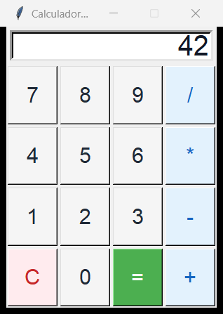
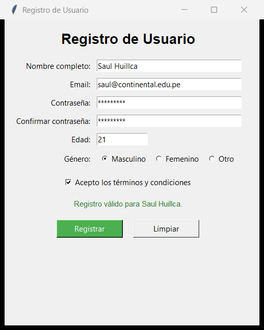

# Semana 13 — Diseño de Interfaces Gráficas (GUI) con Tkinter

Práctica de **Construcción de Software** (Universidad Continental): diseño e implementación de aplicaciones de escritorio en Python con Tkinter aplicando principios de usabilidad, accesibilidad y validación de datos.

## Estructura del proyecto

```text
├── calculadora.py              # Calculadora funcional con GUI
├── formulario.py               # Formulario de registro con validaciones
├── wireframe.png               # Boceto/wireframe del formulario
├── wfcalculadora.png           # Boceto/wireframe de la calculadora
├── capturas/
│   ├── calculadora.png         # Captura de calculadora.py funcionando
│   └── formulario.png          # Captura de formulario.py funcionando
└── README.md                   # Explicación del diseño y principios aplicados
```

## Requisitos y ejecución

Tkinter viene incluido con Python. Verificación del entorno:

```bash
python -c "import tkinter; print(tkinter.TkVersion)"
```

Ejecución de cada aplicación:

```bash
python calculadora.py
python formulario.py
```

---

## Diseño y Wireframes

### Calculadora (`calculadora.py`)
Boceto previo en [wfcalculadora.png](wfcalculadora.png):
- Pantalla superior (`Entry`) alineada a la derecha para mostrar la expresión y el resultado.
- Cuadrícula de 4×4 botones con dígitos (`0–9`), operadores (`+`, `-`, `*`, `/`), limpiar (`C`) y calcular (`=`).

### Formulario de Registro (`formulario.py`)
Boceto previo en [wireframe.png](wireframe.png), con distribución vertical en dos columnas (etiquetas a la derecha, controles a la izquierda), edad con campo reducido, opciones excluyentes para género, casilla de términos, área de retroalimentación visual y botones de acción diferenciados.

---

## Decisiones de diseño: Usabilidad y Accesibilidad

| Principio aplicado | Implementación | Por qué se aplicó |
|---|---|---|
| **Labels descriptivos y alineación** | Etiquetas claras alineadas a la derecha (`anchor="e"`) junto a cada entrada y títulos jerárquicos. | Facilita el escaneo visual y reduce ambigüedades sobre qué dato espera cada campo. |
| **Orden de tabulación (Tab Order)** | Widgets creados en orden lógico (arriba hacia abajo, izquierda a derecha) y foco inicial en *Nombre completo* (`focus_set()`). | Permite navegar todo el formulario únicamente con `Tab` / `Shift+Tab` sin saltos confusos. |
| **Atajos de teclado** | **Calculadora:** teclas `0-9`, `+ - * / .`, `Enter` (`=`), `Esc` (`C`).<br>**Formulario:** `Enter` (Registrar) y `Esc` (Limpiar). | Mejora la accesibilidad y agiliza el uso sin depender exclusivamente del mouse. |
| **Retroalimentación visual** | Botón principal en verde (`#4CAF50`), operador/limpiar diferenciados por color según el wireframe, etiqueta de estado en pantalla y diálogos `messagebox`. | El usuario distingue de inmediato la acción principal, las acciones destructivas y el resultado de sus acciones. |
| **Prevención y manejo de errores** | Contraseñas ocultas (`show="*"`), display de calculadora protegido (`readonly`), captura de división entre cero y validación integral con foco automático al primer campo inválido. | Evita entradas accidentales, protege datos sensibles y guía directamente al usuario para corregir errores. |

---

## Organización del código

Ambas aplicaciones están estructuradas con Programación Orientada a Objetos y separación entre interfaz y lógica:

- **`Calculadora` (`calculadora.py`)**:
  - `_crear_widgets()` y `_configurar_atajos()` encapsulan la UI y los eventos de teclado.
  - `evaluar_expresion()` contiene la lógica pura de validación de caracteres y evaluación aritmética.
- **`FormularioRegistro` (`formulario.py`)**:
  - `crear_widgets()` y `_configurar_atajos()` construyen la interfaz y los atajos.
  - `validar_datos()` separa las reglas de validación (nombre obligatorio, email con regex, contraseña ≥ 8 caracteres, coincidencia de contraseñas, edad entera entre 15 y 99, género y aceptación de términos) de la presentación de errores.

---

## Pruebas realizadas y capturas

### Calculadora (`calculadora.py`)
- `5+3` → `8`
- `7*6` → `42`
- `10/3` → `3.3333333333333335`
- `C` → limpia la pantalla correctamente
- `++` → muestra diálogo *"Expresión inválida"* y limpia la pantalla
- `10/0` → muestra diálogo *"No se puede dividir entre cero"* y limpia la pantalla



### Formulario de Registro (`formulario.py`)
- Envío con campos vacíos → lista todos los errores de validación
- Email sin `@` → error de formato de email
- Contraseñas distintas → error de coincidencia
- Edad `"abc"` → error numérico (`"La edad debe ser un número"`)
- Datos completos válidos → mensaje de bienvenida (`"Registro exitoso"`)
- Botón `Limpiar` / tecla `Esc` → restablece todos los campos y devuelve el foco al inicio


